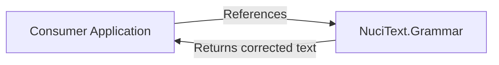
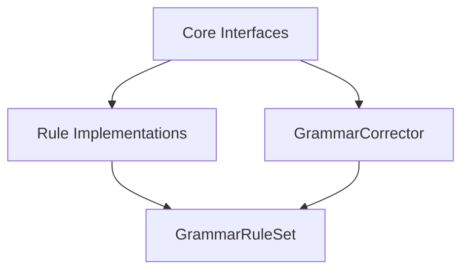
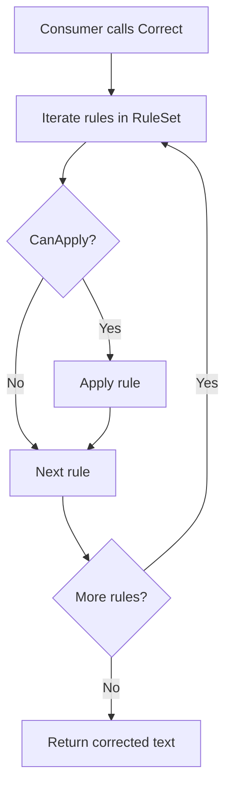
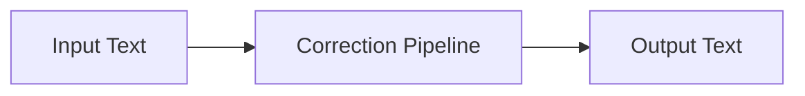
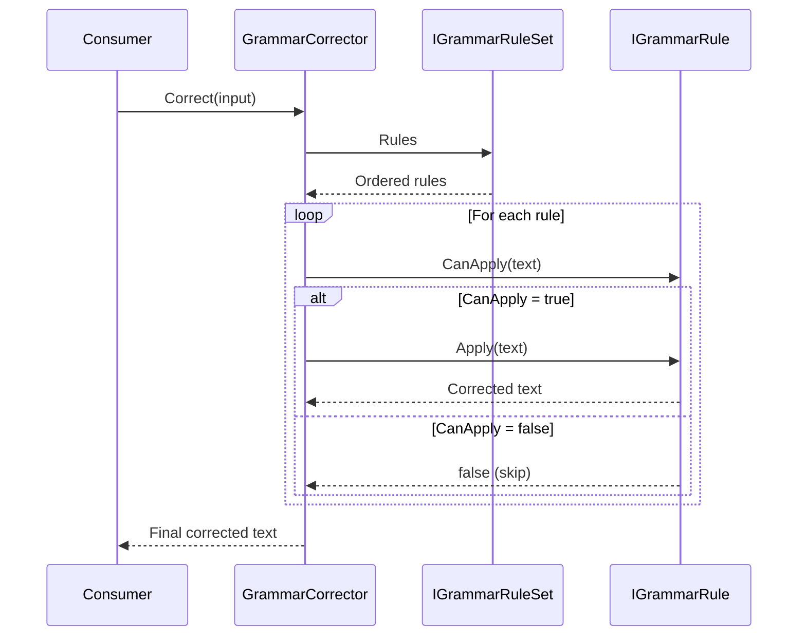
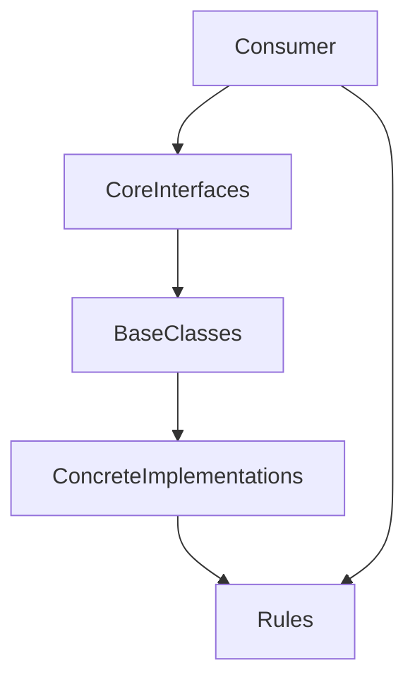

# NuciText.Grammar Architecture

This document describes the current architecture of NuciText.Grammar, a lightweight, dependency-free .NET library for rule-based grammar and text normalisation.

## 📑 Table of Contents

- [Purpose](#-purpose)
- [System Context](#-system-context)
- [Architectural Style](#-architectural-style)
- [Runtime Flow](#-runtime-flow)
- [Components](#-components)
- [Architectural Areas](#-architectural-areas)
- [Data Architecture](#-data-architecture)
- [Interfaces and Integrations](#-interfaces-and-integrations)
- [Key Flows](#-key-flows)
- [Cross-Cutting Concerns](#-cross-cutting-concerns)
- [Dependency Direction and Rules](#-dependency-direction-and-rules)
- [External Dependencies](#-external-dependencies)
- [Deployment and Operations](#-deployment-and-operations)
- [Compatibility Contracts](#-compatibility-contracts)
- [Testing and Verification](#-testing-and-verification)

## 🎯 Purpose

NuciText.Grammar provides a minimal core API for defining and applying grammar correction rules. It is designed for deterministic, rule-based text cleanup pipelines such as whitespace normalisation, punctuation spacing, and language-specific corrections. The library has no external dependencies and operates entirely in-process.

## 🌐 System Context



The principal external boundaries are:
- **Consumer Application:** Calls `IGrammarCorrector.Correct` with input text; receives corrected text. The consumer owns rule set selection and composition.

## 🏗️ Architectural Style

NuciText.Grammar follows a **layered library** pattern with a minimal core and extensibility points:



The principal architecture boundaries are:
- **Core Interfaces (`IGrammarRule`, `IGrammarRuleSet`, `IGrammarCorrector`):** Define the public contract. Stable, versioned.
- **Base Classes (`GrammarRule`, `GrammarRuleSet`):** Provide default implementations and reduce boilerplate for consumers.
- **Concrete Implementations (`GrammarCorrector`, `TrimWhitespaceRule`):** Ready-to-use implementations.
- **Consumer Extensions:** Consumers implement `IGrammarRule` and `IGrammarRuleSet` for custom logic.

## 🔄 Runtime Flow



The principal runtime sequence is:
1. Consumer instantiates a `GrammarRuleSet` implementation and passes it to `GrammarCorrector`
2. Consumer calls `GrammarCorrector.Correct(inputText)`
3. `GrammarCorrector` iterates the rule set's `Rules` in order
4. For each rule, if `CanApply` returns `true`, `Apply` is invoked
5. The output of each rule becomes the input to the next
6. Final corrected text is returned

## 🧩 Components

| Component | Responsibility | Principal Dependencies | Lifetime or Ownership |
|-----------|----------------|------------------------|-----------------------|
| `IGrammarRule` | Defines a single correction rule contract | None | Interface, consumer-owned |
| `IGrammarRuleSet` | Defines an ordered list of rules for a language/scenario | `IGrammarRule` | Interface, consumer-owned |
| `IGrammarCorrector` | Defines the text correction entry point | `IGrammarRuleSet` | Interface, consumer-owned |
| `GrammarRule` | Abstract base class with default `CanApply` logic | None | Library-provided, extensible |
| `GrammarRuleSet` | Abstract base class for rule set implementations | `IGrammarRule` | Library-provided, extensible |
| `GrammarCorrector` | Applies all rules in a rule set to text | `IGrammarRuleSet` | Library-provided, sealed |
| `GrammarRuleException` | Exception type for rule execution failures | `Exception` | Library-provided |
| `TrimWhitespaceRule` | Built-in whitespace normalisation rule | `GrammarRule` | Library-provided, sealed |

## 🗂️ Architectural Areas

### Core

Paths:
- `NuciText.Grammar/IGrammarRule.cs`
- `NuciText.Grammar/IGrammarRuleSet.cs`
- `NuciText.Grammar/IGrammarCorrector.cs`
- `NuciText.Grammar/GrammarRule.cs`
- `NuciText.Grammar/GrammarRuleSet.cs`
- `NuciText.Grammar/GrammarCorrector.cs`
- `NuciText.Grammar/GrammarRuleException.cs`

Responsibilities:
- Define public contracts
- Provide base implementations
- Implement the correction pipeline

Boundary rules:
- No external dependencies
- Interfaces are stable and versioned
- Base classes are extensible but not sealed

### Rules

Paths:
- `NuciText.Grammar/Rules/TrimWhitespaceRule.cs`
- `NuciText.Grammar/Rules/PatternReplacementRuleBase.cs`
- `NuciText.Grammar/Rules/SpacingRule.cs`

Responsibilities:
- Provide reusable rule implementations
- Demonstrate extension patterns

Boundary rules:
- Rules depend only on core interfaces and base classes
- New rules should be added here or in consumer projects

## 💾 Data Architecture

NuciText.Grammar is stateless. It processes input strings and returns output strings without persisting any data.



| Data or Store | Owner | Representation and Storage | Lifecycle or Consistency |
|---------------|-------|----------------------------|--------------------------|
| Input text | Consumer | `string` (in-memory) | Transient, per-call |
| Intermediate text | `GrammarCorrector` | `string` (in-memory) | Transient, per-rule |
| Output text | Consumer | `string` (in-memory) | Transient, per-call |

## 🔌 Interfaces and Integrations

| Interface or Integration | Direction | Contract | Owner | Failure Semantics |
|--------------------------|-----------|----------|-------|-------------------|
| `IGrammarCorrector.Correct` | Inbound | `string Correct(string text)` | `GrammarCorrector` | Throws `GrammarRuleException` on rule failure |
| `IGrammarRule.Apply` | Inbound | `string Apply(string text)` | Rule implementer | Throws `GrammarRuleException` on failure |
| `IGrammarRule.CanApply` | Inbound | `bool CanApply(string text)` | Rule implementer | Returns `false` to skip |
| `IGrammarRuleSet.Rules` | Inbound | `IReadOnlyList<IGrammarRule> Rules` | Rule set implementer | Returns ordered rules |

## 🔀 Key Flows

### Text Correction



The correction flow is deterministic and sequential. Rule ordering in the rule set determines the final output. Each rule receives the output of the previous rule.

## ⚙️ Cross-Cutting Concerns

### Security and Privacy

- The library performs in-memory string transformations only
- No file system, network, or external resource access
- No logging, caching, or retention of input/output text
- No telemetry or data collection
- Consumer controls all data lifetime

### Error Handling

- `GrammarRuleException` wraps rule execution failures
- `GrammarCorrector` propagates exceptions from rules
- `CanApply` returning `false` is not an error; the rule is skipped
- Consumers should catch `GrammarRuleException` if they need to handle rule failures

### Observability

- No built-in logging, metrics, or tracing
- Consumers can wrap `Correct` calls for their own observability

### Configuration

- No configuration system in the library
- Rule sets are configured by consumers via code
- Rule behaviour is determined by rule implementation

### Concurrency and Resource Use

- `GrammarCorrector` is stateless and thread-safe
- Rules should be stateless for thread safety
- No shared state, locks, or resource pooling
- Memory allocation proportional to input text length

## 🧭 Dependency Direction and Rules



The principal dependency rules are:
- Core interfaces have no dependencies
- Base classes depend only on core interfaces
- Concrete implementations depend on base classes and interfaces
- Rules depend on base classes or interfaces
- Consumers depend on interfaces and base classes
- No circular dependencies
- No external dependencies at any layer

## 📦 External Dependencies

None. NuciText.Grammar has zero external dependencies.

## 🚀 Deployment and Operations

| Concern | Current Design | Architectural Consequence |
|---------|----------------|---------------------------|
| Distribution | NuGet package | Consumers add via `dotnet add package` |
| Runtime | .NET 10.0+ | Requires compatible .NET runtime |
| Native dependencies | None | Fully managed, cross-platform |
| Versioning | Semantic versioning | Breaking changes require major version |

## 🛡️ Compatibility Contracts

| Contract | Owner | Invariant | Verification | Change Policy |
|----------|-------|-----------|--------------|---------------|
| `IGrammarRule` | Library | Method signatures stable | Compile-time | Major version for breaking changes |
| `IGrammarRuleSet` | Library | Method signatures stable | Compile-time | Major version for breaking changes |
| `IGrammarCorrector` | Library | Method signatures stable | Compile-time | Major version for breaking changes |
| `GrammarRuleException` | Library | Constructor signatures stable | Compile-time | Major version for breaking changes |

## ✅ Testing and Verification

The project includes a unit test project (`NuciText.Grammar.UnitTests`) covering:
- `GrammarCorrector` behaviour with various rule sets
- `GrammarRule` base class default behaviour
- `TrimWhitespaceRule` functionality
- Custom rule implementations

Execute the principal automated verification with:

```bash
dotnet test
```