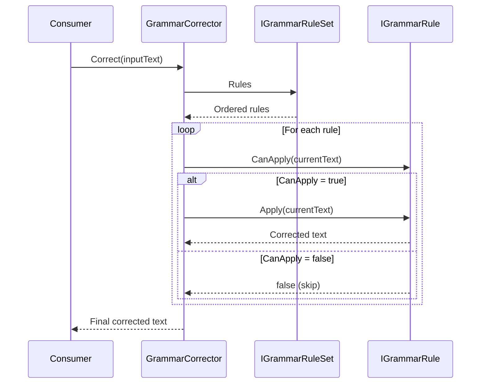

# Flows

## Text correction flow

### Overview

The primary flow is text correction via `GrammarCorrector.Correct()`.

### Sequence



### Step-by-step

1. **Consumer instantiates** a `GrammarRuleSet` implementation and passes it to `GrammarCorrector` constructor
2. **Consumer calls** `GrammarCorrector.Correct(inputText)`
3. **GrammarCorrector validates** input is not null (throws `ArgumentNullException`)
4. **GrammarCorrector retrieves** ordered rules from `ruleSet.Rules`
5. **For each rule** in order:
   - Calls `rule.CanApply(currentText)`
   - If `true`: calls `rule.Apply(currentText)`, result becomes `currentText`
   - If `false`: skips rule, `currentText` unchanged
6. **Returns** final `currentText` to consumer

### Error paths

| Condition | Behavior |
|-----------|----------|
| `ruleSet` is null in constructor | `ArgumentNullException` |
| `text` is null in `Correct()` | `ArgumentNullException` |
| `rule.CanApply()` throws | Exception propagates to consumer |
| `rule.Apply()` throws | Exception propagates to consumer |
| `rule.Apply()` throws internally | Should wrap in `GrammarRuleException` |

### Rule application order

Rules are applied **in the order returned by `IGrammarRuleSet.Rules`**. This order is significant when multiple rules can affect the same text regions.

Example with `TrimWhitespaceRule` followed by `SpacingRule`:
1. Input: `"  Hello  ,  world  "`
2. After TrimWhitespaceRule: `"Hello , world"`
3. After SpacingRule: `"Hello, world"`

Reversed order would produce different results.

## Rule implementation flow

### Creating a custom rule

1. **Inherit** from `GrammarRule` (or implement `IGrammarRule` directly)
2. **Implement** `Id` (unique string identifier)
3. **Implement** `Description` (human-readable)
4. **Implement** `DoApply(string text)` — actual correction logic
5. **Optionally override** `CheckApplicability(string text)` for efficient pre-check

### Creating a custom rule set

1. **Inherit** from `GrammarRuleSet` (or implement `IGrammarRuleSet` directly)
2. **Implement** `LanguageCode` — IETF language tag
3. **Implement** `Rules` — return ordered `IReadOnlyList<IGrammarRule>`
4. **Instantiate** rules in desired application order

### Using the corrector

```csharp
IGrammarRuleSet ruleSet = new MyLanguageRuleSet();
IGrammarCorrector corrector = new GrammarCorrector(ruleSet);
string corrected = corrector.Correct(inputText);
```